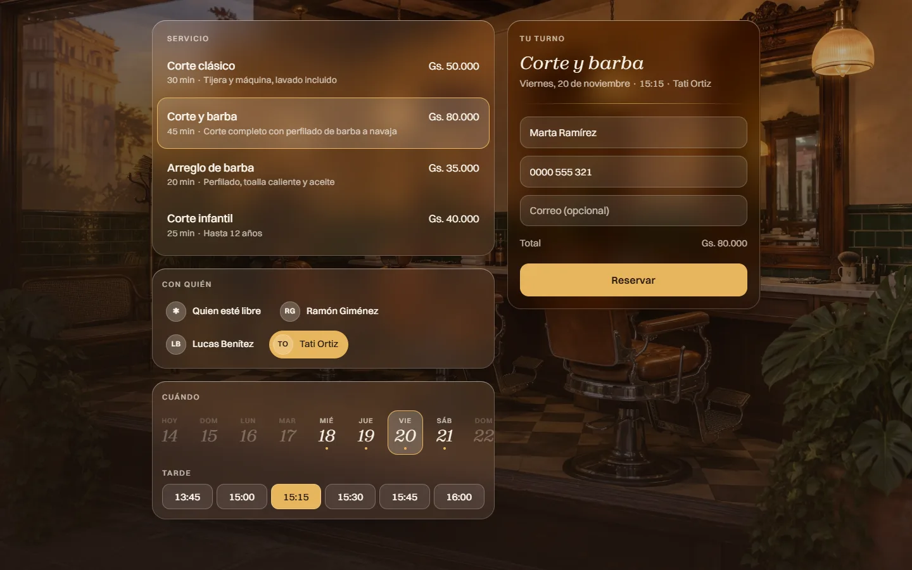
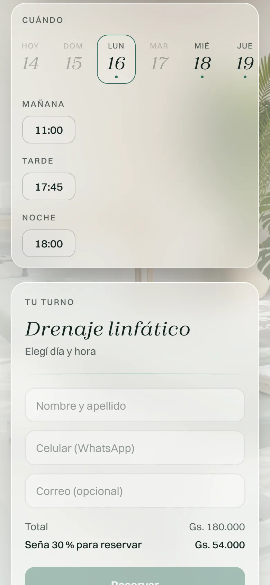
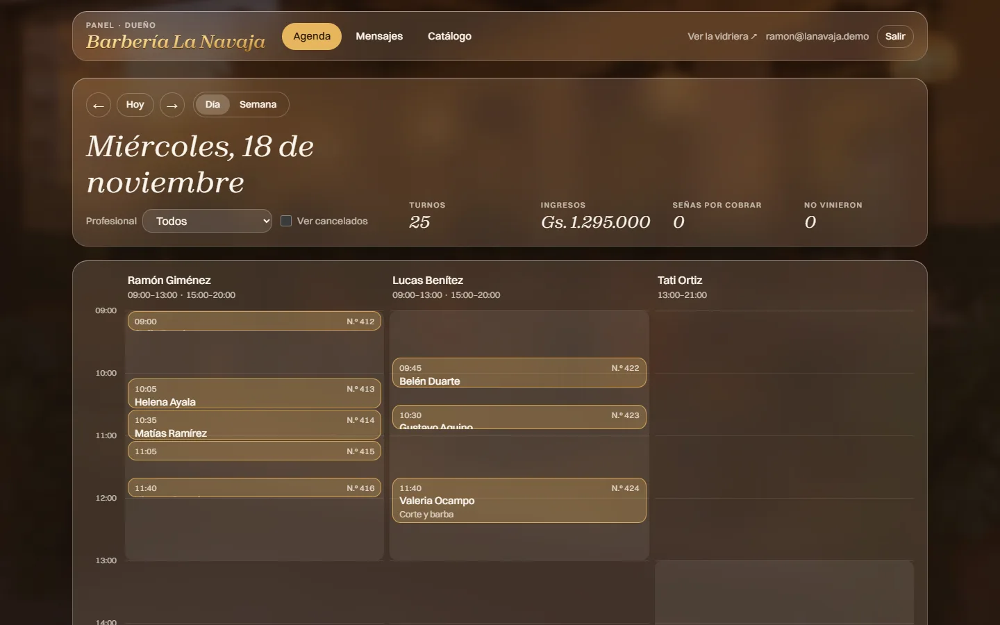
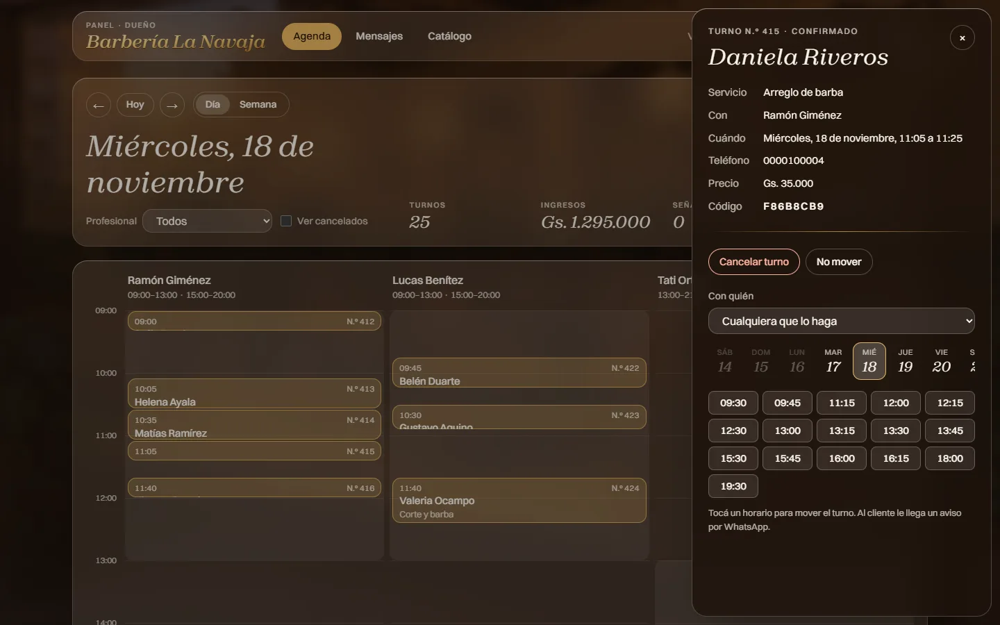
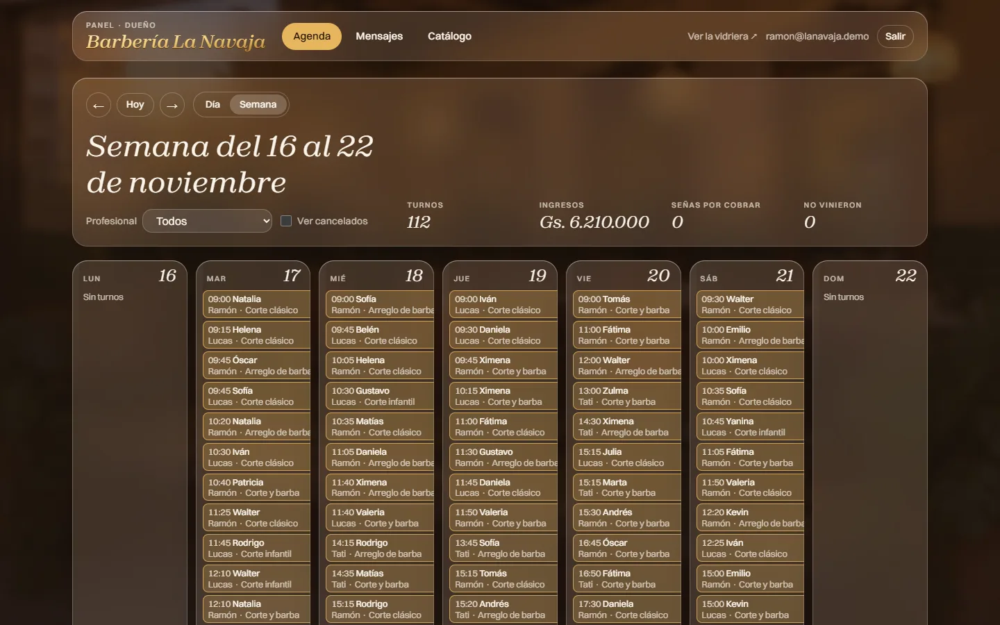
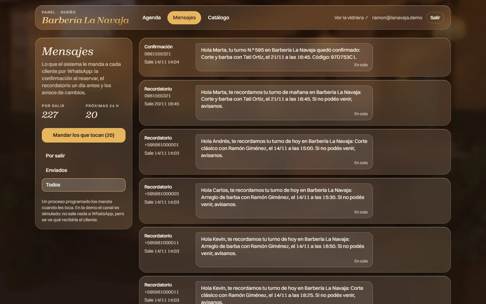

# Talón

[](https://github.com/nandres/talon/actions/workflows/ci.yml)

Turnos en línea para negocios de barrio. Cada negocio tiene su vidriera: el cliente elige servicio, profesional y horario, paga la seña si hace falta y se lleva su número. Detrás del mostrador, el equipo ve la agenda del día, mueve turnos y sigue los avisos que salen por WhatsApp.

**En línea:** https://talon-turnos.vercel.app · panel en [/panel/entrar](https://talon-turnos.vercel.app/panel/entrar), con cuentas de demostración



> **Software propietario.** Ver [LICENSE](LICENSE). Los negocios, las personas y las fotos de la demo son ficticios; las fotos fueron generadas con IA.

## Qué hace

**Para el cliente**
- Elige servicio, profesional (o "quien esté libre") y un horario entre los que de verdad están libres.
- Recibe su número y un enlace para consultar el turno. Si el local pide seña, la paga desde ahí.
- Le llega la confirmación, un recordatorio el día anterior y un aviso si le mueven o cancelan el turno.

**Para el negocio**
- Agenda por día (una columna por profesional, con horario de atención, bloqueos y la hora actual) y por semana.
- Ficha de cada turno: marcar atendido o ausente, cancelar, cobrar la seña en el local o **mover el turno** a otro hueco.
- Bandeja con los mensajes tal como los recibe el cliente.
- Catálogo editable: servicios y precios, quién hace qué y horarios semanales.
- Varios negocios en la misma base, cada uno con su dueño y su equipo.

| | |
|---|---|
|  |  |
|  |  |
|  |  |

## Cómo está resuelto

- **Dos personas no pueden sacar el mismo horario.** Una restricción de exclusión de PostgreSQL (`btree_gist` sobre el rango de cada profesional) lo impide en la base, no en la interfaz. Hay una prueba que lanza seis reservas simultáneas del mismo horario y verifica que entra una sola.
- **La seguridad vive en la base.** Row Level Security separa a los negocios. El público solo ve el catálogo, y lo ocupado le llega como rangos de tiempo sin datos personales. Reservar, cambiar estados, mover turnos y guardar horarios pasa por funciones que validan quién llama.
- **Pagos como en una pasarela real.** La demo trae una pasarela simulada, sin datos de tarjeta, que avisa al comercio con un POST firmado (HMAC-SHA256 con marca de tiempo). Cada aviso se procesa una sola vez, aunque llegue repetido. Si el cliente paga cuando el horario ya se liberó, el pago queda marcado para devolver. Para usar Pagopar o Bancard alcanza con otra implementación del adaptador.
- **Cola de mensajes.** Cada aviso lo toma un solo proceso (`FOR UPDATE SKIP LOCKED`). Si el envío falla, se reintenta con espera creciente. El canal es un adaptador: en la demo es simulado y no sale nada a WhatsApp.
- **Hora de Asunción bien calculada.** Los turnos se guardan en UTC y se calculan con la base de zonas horarias, así que el cambio de Paraguay a UTC-3 fijo no rompe nada.
- **Diseño "La vidriera".** La foto del local va detrás de paneles de vidrio esmerilado, el nombre aparece pintado en el vidrio y el número final se ve como limpiado con el dedo sobre un vidrio empañado. Las animaciones están hechas con Motion y se apagan si el sistema pide reducir el movimiento.

## Stack

| Capa | Tecnología |
|---|---|
| Aplicación | Next.js 16, React 19 y TypeScript |
| Estilos y animación | Tailwind CSS 4, Motion; fuentes Zodiak y Switzer (Fontshare) |
| Base de datos y cuentas | Supabase: PostgreSQL con RLS, Auth y pg_cron |
| Publicación | Vercel, con Vercel Cron para los mensajes |
| Pruebas | `node --test` contra un Supabase local; CI en GitHub Actions |

## Correrlo

Requiere Node.js 24, Docker y la CLI de Supabase.

```bash
npm ci
npx supabase start          # base local con migraciones y datos de ejemplo
cp .env.example .env.local  # completar con lo que muestra `npx supabase status`
npm run dev                 # http://localhost:3210
```

Para entrar al panel, `/panel/entrar` tiene botones con las cuentas de la demo.

```bash
npm run typecheck
npm test        # 35 pruebas: disponibilidad, RLS, concurrencia, panel, pagos y cola
npm run build
```

Hecho por **Marcos Arellano** · [marcos-arellano.vercel.app](https://marcos-arellano.vercel.app)
